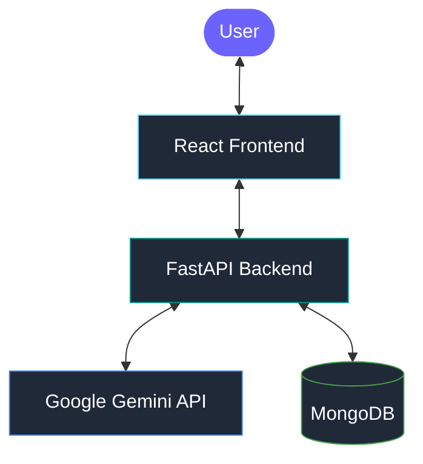

<div align="center">

# ✨ SIVA AI

### Your AI. Your Conversations. Your Intelligence.

**A modern AI-powered conversational assistant built with React, FastAPI, Google Gemini, and MongoDB.**

<br/>

<a href="https://siva-ai-one.vercel.app/">
  
</a>
<a href="https://github.com/sachinydv0002/">
  
</a>
<a href="https://www.youtube.com/@Sachinydv0002-sde">
  
</a>

<br/><br/>


<br/><br/>

**[Open Siva AI ↗](https://siva-ai-one.vercel.app/)**

</div>

---

## 📖 About Siva AI

**Siva AI** is a full-stack conversational AI application designed to make interacting with artificial intelligence simple, intuitive, and accessible.

Powered by Google's Gemini API, Siva AI combines a modern React interface with a Python FastAPI backend and MongoDB for data persistence. The application focuses on natural conversations, convenient chat navigation, conversation history, and a responsive experience across desktop and mobile devices.

### 🎯 Project Goals

- Build a clean and intuitive AI chat experience.
- Integrate Google's Gemini API through a backend service.
- Support conversation context using available chat history.
- Store application data using MongoDB.
- Deliver a responsive interface for desktop and mobile users.
- Maintain a modular architecture that can grow with new features.

---

## ✨ Features

<table>
<tr>
<td width="50%" valign="top">

### 🤖 AI Conversations

- AI-generated responses using Google Gemini.
- Interactive conversational interface.
- Context-aware follow-up conversations using available history.
- Backend-based AI API integration.

</td>
<td width="50%" valign="top">

### 💬 Modern Chat UI

- Clean React-based interface.
- Dedicated new-chat experience.
- Suggested prompts on the new-chat screen.
- Responsive desktop and mobile layouts.
- Contextual message controls where implemented.

</td>
</tr>
<tr>
<td width="50%" valign="top">

### 🧠 Chat History & Memory

- MongoDB-based data persistence.
- Conversation-specific message retrieval.
- Recent chat history for conversational context.
- Separate concepts for chat history and saved memory.
- Saved-memory interface where implemented.

</td>
<td width="50%" valign="top">

### 📱 Responsive Experience

- Mobile-friendly layout.
- Keyboard-aware mobile UI adjustments.
- Sidebar navigation and conversation controls.
- Touch-friendly interactions.
- Settings and contextual popups where implemented.

</td>
</tr>
<tr>
<td width="50%" valign="top">

### ⚡ Backend & API

- Python and FastAPI backend.
- Gemini API integration.
- MongoDB connectivity.
- Uvicorn application server.
- Interactive API documentation through Swagger UI.

</td>
<td width="50%" valign="top">

### 🧩 Modular Architecture

- Separate frontend and backend.
- Centralized backend integration for AI requests.
- Persistent data storage where configured.
- Extendable structure for future AI capabilities.

</td>
</tr>
</table>

---

## 🛠️ Technology Stack

<div align="center">

| Layer | Technology | Role |
|:---|:---|:---|
| Frontend | React | User interface |
| Language | JavaScript | Frontend functionality |
| Styling | CSS | Layout and responsive design |
| Backend | Python | Application logic |
| API Framework | FastAPI | Backend endpoints |
| AI Integration | Google Gemini API | AI response generation |
| Database | MongoDB | Persistent data storage |
| ASGI Server | Uvicorn | Runs the FastAPI application |
| Version Control | Git & GitHub | Source code management |
| Frontend Hosting | Vercel | Live frontend deployment |

</div>

---

## 🏗️ System Architecture



### 🔄 How It Works

1. The user sends a message through the React frontend.
2. The frontend forwards the request to the FastAPI backend.
3. The backend prepares the AI request and available conversation context.
4. The backend communicates with the Google Gemini API.
5. MongoDB stores or retrieves conversation data according to the implementation.
6. The backend returns the generated response.
7. The frontend displays the response in the chat interface.

---

## 📂 Project Structure

The structure below represents the expected organization of the application. Actual files may vary.

```text
Siva-AI/
│
├── backend/
│   ├── app/
│   │   └── main.py
│   ├── requirements.txt
│   └── .env
│
├── frontend/
│   ├── public/
│   ├── src/
│   │   ├── App.jsx
│   │   ├── App.css
│   │   └── ...
│   ├── package.json
│   └── index.html
│
├── .gitignore
└── README.md
```

---

## 🚀 Getting Started

Follow these steps to set up Siva AI locally.

### Prerequisites

Make sure the following tools are installed:

- **Python** — 3.10 or newer
- **Node.js and npm**
- **Git**
- **Google Gemini API key**
- **MongoDB or MongoDB Atlas**, if required by the backend

### 1. Clone the Repository

```bash
git clone https://github.com/sachinydv0002/Siva-AI.git
cd Siva-AI
```

> Make sure the repository URL and name match your actual GitHub repository.

### 2. Set Up the Backend

Navigate to the backend directory:

```bash
cd backend
```

Create a virtual environment:

```bash
python -m venv .venv
```

Activate it on Windows PowerShell:

```powershell
.\.venv\Scripts\Activate.ps1
```

On macOS or Linux:

```bash
source .venv/bin/activate
```

Install the backend dependencies:

```bash
pip install -r requirements.txt
```

### 3. Configure Environment Variables

Create a `.env` file inside the backend directory if your backend uses environment variables.

Example:

```env
GEMINI_API_KEY=your_gemini_api_key
MONGODB_URI=your_mongodb_connection_string
DATABASE_NAME=siva_ai
```

**Configuration notes:**

- Use the exact variable names expected by your Python code.
- The variables above are examples; your application may use different names.
- Keep API keys and database credentials private.
- Never commit your `.env` file to a public repository.

### 4. Start the Backend

From the backend directory, run:

```bash
uvicorn app.main:app --reload
```

If your application uses `app.main:app` and the default Uvicorn port, the local endpoints will be:

| Service | Address |
|:---|:---|
| Backend API | `http://127.0.0.1:8000` |
| Swagger UI | `http://127.0.0.1:8000/docs` |
| ReDoc | `http://127.0.0.1:8000/redoc` |

### 5. Set Up the Frontend

Open a second terminal and navigate to the frontend directory:

```bash
cd frontend
```

Install dependencies:

```bash
npm install
```

Start the development server:

```bash
npm run dev
```

Open the local URL printed in your terminal.

If the frontend requires a backend URL, configure the environment variable expected by the existing frontend code.

---

## 🔑 Environment Variables

The backend configuration may include the following values:

| Variable | Purpose |
|:---|:---|
| `GEMINI_API_KEY` | Authenticates requests to Google Gemini |
| `MONGODB_URI` | Connects the backend to MongoDB |
| `DATABASE_NAME` | Selects the MongoDB database |
| Frontend API URL | Specifies the backend address, if configurable |

Check the actual code before using these example names.

**Never expose private backend API keys in frontend code.**

---

## 🔌 API Documentation

Siva AI uses FastAPI to provide backend API functionality.

After starting the backend, open:

**Swagger UI:** `http://127.0.0.1:8000/docs`

The documentation page displays the endpoints and request/response schemas registered by the application.

The exact routes, request fields, and response formats depend on the current backend implementation.

---

## 🗄️ Database

MongoDB provides persistent storage where configured.

Depending on the implementation, it can support:

- Conversation and message records.
- Chat-specific message retrieval.
- Conversation identifiers and ownership.
- Recent conversation context.
- Saved-memory data where implemented.

For production use, configure appropriate database permissions and secure the connection string.

---

## 🌐 Deployment

### Frontend — Vercel

The live Siva AI frontend is available here:

<div align="center">

<a href="https://siva-ai-one.vercel.app/">
  
</a>

<br/><br/>

**https://siva-ai-one.vercel.app/**

</div>

For future deployments:

1. Push your latest changes to GitHub.
2. Open the project in Vercel.
3. Verify the configured root directory.
4. Confirm the build command and output directory.
5. Configure the required frontend environment variables.
6. Deploy the application.
7. Test the deployed frontend and backend integration.

### Backend

The FastAPI backend needs a hosting environment that supports Python applications unless your deployment architecture explicitly handles it another way.

For a production deployment:

- Configure backend environment variables.
- Set appropriate CORS origins.
- Verify MongoDB connectivity.
- Verify Gemini API connectivity.
- Configure the frontend to use the deployed backend URL.
- Test requests, errors, and persistence.

> **Important:** Frontend and backend deployments are separate unless your infrastructure explicitly combines them.

---

## 🔐 Security

Follow these practices when developing or deploying Siva AI:

- Keep API keys and database credentials private.
- Exclude `.env` files from Git.
- Process Gemini API requests through the backend.
- Configure CORS for trusted frontend origins.
- Validate incoming requests.
- Handle API and database errors safely.
- Use appropriate MongoDB permissions.
- Avoid logging sensitive information.
- Keep development and production settings separate.

---

## 🗺️ Future Roadmap

Potential areas for continued development:

- Additional AI capabilities and tools.
- Improved accessibility and keyboard navigation.
- Expanded conversation management.
- Further personalization features.
- Automated testing and monitoring.
- Performance optimization.
- Improved deployment automation.

---

## 👨‍💻 Developer

<div align="center">

### Sachin Kumar

<a href="https://github.com/sachinydv0002/">
  
</a>
<a href="https://www.youtube.com/@Sachinydv0002-sde">
  
</a>

<br/><br/>

**Building Siva AI with React, FastAPI, Google Gemini, and MongoDB.**

</div>

---

<div align="center">

### 💜 Experience Siva AI

**[🌐 Visit the Live Website](https://siva-ai-one.vercel.app/)**

*Making AI conversations smarter, simpler, and more accessible.*

<br/>

<sub>Designed and developed by Sachin Kumar.</sub>

</div>
