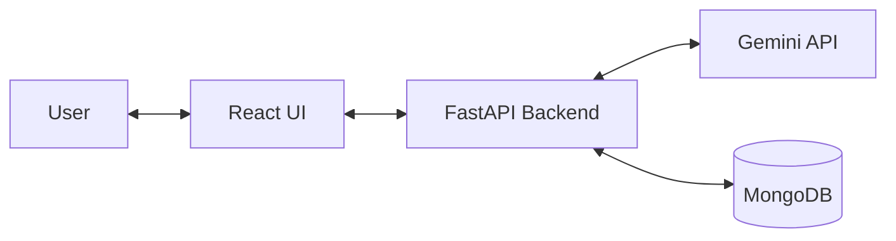

# 🚀 Siva AI

### Your Intelligent AI-Powered Personal Assistant

Siva AI is a full-stack conversational AI assistant powered by **Google Gemini**, built with **React, FastAPI, Python, and MongoDB**. It combines intelligent response generation, real-time chat streaming, and persistent conversation storage in a modern web application.

<p align="center">
  
  
  
  
</p>

## ✨ Key Features

- 🤖 **Intelligent AI Chat** — Generate contextual responses using Google's Gemini API.
- ⚡ **Real-Time Streaming** — Display responses progressively for a smoother conversational experience.
- 💬 **Modern Chat Interface** — Interact through a responsive React frontend.
- 🗄️ **Conversation Persistence** — Store chat data using MongoDB.
- ⚙️ **FastAPI Backend** — Process chat requests through a Python REST API.
- 🔌 **API Integration** — Connect the frontend, AI service, and database through a backend layer.
- 📖 **Interactive API Docs** — Explore backend endpoints using Swagger UI.

## 🛠️ Tech Stack

| Layer | Technology |
|---|---|
| Frontend | React, JavaScript |
| Backend | Python, FastAPI |
| AI Engine | Google Gemini API |
| Database | MongoDB |
| ASGI Server | Uvicorn |
| Version Control | Git, GitHub |

## 🏗️ Architecture



**Workflow:** The React frontend sends user messages to FastAPI. The backend communicates with Gemini to generate responses and uses MongoDB for conversation storage. Responses are delivered to the frontend, with streaming handled by the application's configured response mechanism.

## ⚙️ Getting Started

### Prerequisites

- Python 3.10+
- Node.js and npm
- MongoDB or MongoDB Atlas
- Google Gemini API key

### 1. Clone the Repository

```bash
git clone https://github.com/YOUR_USERNAME/Siva-AI.git
cd Siva-AI
```

### 2. Configure the Backend

```bash
cd backend
python -m venv venv
```

Activate the virtual environment on Windows:

```powershell
.\venv\Scripts\Activate.ps1
```

Install dependencies:

```bash
pip install -r requirements.txt
```

Create a `.env` file inside `backend/`:

```env
GEMINI_API_KEY=your_gemini_api_key
MONGODB_URI=your_mongodb_connection_string
DATABASE_NAME=siva_ai
```

Use the environment-variable names configured in your actual backend code.

### 3. Start the Backend

```bash
uvicorn app.main:app --reload
```

Backend: `http://127.0.0.1:8000`

API Documentation: `http://127.0.0.1:8000/docs`

### 4. Start the Frontend

Open a new terminal:

```bash
cd frontend
npm install
npm run dev
```

Open the local development URL shown in the terminal.

## 🔌 API Reference

| Method | Endpoint | Description |
|---|---|---|
| `POST` | `/api/chat` | Submit a message and receive an AI response |

Example request:

```json
{
  "message": "Hello, Siva AI!"
}
```

The actual response schema and streaming format depend on the backend implementation.

## 🔐 Security

- Keep API keys and database credentials in environment variables.
- Never commit `.env` files or secrets to GitHub.
- Make Gemini API calls through the backend rather than exposing credentials in the frontend.
- Configure CORS and validate requests before production deployment.

## 🚀 Future Improvements

- [ ] Enhanced conversation history
- [ ] Chat management and deletion
- [ ] User authentication
- [ ] Improved error handling and testing
- [ ] Production deployment

## 👨‍💻 Author

**Sachin Kumar**

GitHub: [@YOUR_USERNAME](https://github.com/sachinydv0002/)

---

<p align="center">
  <b>Built with React, FastAPI, Google Gemini, and MongoDB.</b>
  <br />
  Making AI conversations smarter, faster, and more accessible. 🚀
</p>
