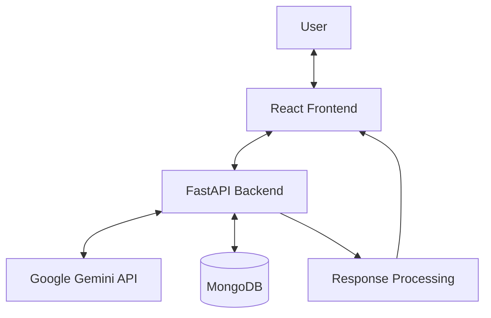

\<div align="center">

# 🚀 Siva AI

### Your Intelligent AI-Powered Personal Assistant

**A modern AI chat application powered by Google Gemini, React, FastAPI, Python, and MongoDB.**

\<br/>

\<a href="[https://siva-ai-one.vercel.app/](https://siva-ai-one.vercel.app/)">
&#x20; \
\</a>
\<a href="[https://github.com/sachinydv0002/](https://github.com/sachinydv0002/)">
&#x20; \
\</a>
\<a href="[https://www.youtube.com/@Sachinydv0002-sde](https://www.youtube.com/@Sachinydv0002-sde)">
&#x20; \
\</a>

\<br/>\<br/>

\
\
\
\
\
\

\</div>

---

## 📌 About the Project

**Siva AI** is a full-stack conversational AI assistant designed to provide an intuitive and responsive AI chat experience.

Built using **React, JavaScript, Python, FastAPI, Google Gemini API, and MongoDB**, the application combines a modern frontend with a Python backend to generate AI-powered responses and manage conversation data.

Siva AI focuses on a clean user interface, convenient chat navigation, conversation history, and a responsive experience across desktop and mobile devices.

🔗 **Try it live:** [siva-ai-one.vercel.app](https://siva-ai-one.vercel.app/)

---

## ✨ Features

### 🤖 AI-Powered Conversations

- Generate AI responses using the Google Gemini API.
- Send messages through an interactive chat interface.
- Use available conversation context to support follow-up questions.
- Process AI requests through the backend.

### 💬 Modern Chat Interface

- Clean, responsive chat UI built with React.
- Dedicated new-chat experience.
- Suggested prompts on the new-chat screen.
- Message actions and contextual controls where implemented.
- Responsive layout for desktop and mobile screens.
- Mobile keyboard-aware layout adjustments.

### 🗂️ Chat History and Saved Memory

- Store conversation data in MongoDB.
- Retrieve recent messages for conversation context.
- Organize messages by conversation and chat identifiers.
- Provide a saved-memory interface where implemented.
- Keep chat history and saved memory as separate concepts.

### 🎨 User Interface and Navigation

- Sidebar navigation and conversation controls.
- New-chat workflow.
- Settings and saved-memory interface where implemented.
- Contextual menus, notifications, and feature popups.
- Touch-friendly adjustments for mobile devices.

### ⚡ Backend and API

- Python backend built with FastAPI.
- Integration with the Google Gemini API.
- MongoDB persistence where configured.
- Uvicorn ASGI server.
- Interactive API documentation through Swagger UI.

### 🔌 Modular Architecture

- Separate frontend and backend layers.
- Centralized backend integration for AI requests.
- Extendable structure for future AI tools and personalization.

> **Note:** Features and implementation details can vary with the current codebase. Refer to the actual application and backend routes for exact behavior.

---

## 🛠️ Tech Stack

| Technology            | Purpose                         |
| --------------------- | ------------------------------- |
| **React**             | Frontend UI                     |
| **JavaScript**        | Frontend functionality          |
| **CSS**               | Styling and responsive layouts  |
| **Python**            | Backend development             |
| **FastAPI**           | Backend REST API                |
| **Google Gemini API** | AI response generation          |
| **MongoDB**           | Database and persistent storage |
| **Uvicorn**           | ASGI application server         |
| **Git & GitHub**      | Version control                 |
| **Vercel**            | Frontend hosting, as configured |

---

## 🏗️ System Architecture



### Request Flow

1. The user enters a message in the React interface.
2. The frontend sends the request to the FastAPI backend.
3. The backend prepares the request and available conversation context.
4. The backend communicates with the Google Gemini API.
5. MongoDB stores or retrieves conversation data as configured.
6. The backend returns the response.
7. The frontend displays the response in the chat interface.

---

## 📁 Project Structure

The following is a representative structure. Actual files and folders may differ in the current repository.

```text
Siva-AI/
│
├── backend/
│   ├── app/
│   │   └── main.py
│   ├── requirements.txt
│   └── .env
│
├── frontend/
│   ├── public/
│   ├── src/
│   │   ├── App.jsx
│   │   ├── App.css
│   │   └── ...
│   ├── package.json
│   └── index.html
│
├── .gitignore
└── README.md
```

---

## ⚙️ Getting Started

Follow these steps to run Siva AI locally.

### Prerequisites

Make sure you have installed:

- Python 3.10 or newer
- Node.js and npm
- Git
- A Google Gemini API key
- MongoDB or a MongoDB Atlas connection, if required by your backend configuration

### 1. Clone the Repository

Use your actual repository URL in the command below:

```bash
git clone https://github.com/sachinydv0002/Siva-AI.git
cd Siva-AI
```

### 2. Set Up the Backend

Navigate to the backend folder:

```bash
cd backend
```

Create a virtual environment:

```bash
python -m venv venv
```

Activate it on Windows PowerShell:

```powershell
.\venv\Scripts\Activate.ps1
```

Install dependencies:

```bash
pip install -r requirements.txt
```

On macOS or Linux, activate the virtual environment with:

```bash
source venv/bin/activate
```

### 3. Configure Environment Variables

Create a `.env` file in the backend directory if your application uses environment variables.

Example configuration:

```env
GEMINI_API_KEY=your_gemini_api_key
MONGODB_URI=your_mongodb_connection_string
DATABASE_NAME=siva_ai
```

**Important:**

- Use the exact variable names expected by your backend code.
- The names above are examples and may need to be adjusted.
- Never upload API keys, database credentials, or private environment files to GitHub.

### 4. Run the Backend

From the backend directory, run:

```bash
uvicorn app.main:app --reload
```

If your FastAPI application uses this module path and the default port, the backend will be available at:

| Service    | Local Address                 |
| ---------- | ----------------------------- |
| API Server | `http://127.0.0.1:8000`       |
| Swagger UI | `http://127.0.0.1:8000/docs`  |
| ReDoc      | `http://127.0.0.1:8000/redoc` |

### 5. Set Up the Frontend

Open a second terminal and navigate to the frontend directory:

```bash
cd frontend
```

Install the dependencies:

```bash
npm install
```

Start the development server:

```bash
npm run dev
```

Open the local URL displayed in your terminal.

If the frontend requires a backend API URL, configure it using the environment-variable name expected by your frontend code.

---

## 🔑 Environment Configuration

Depending on your implementation, the application may use the following configuration values:

| Variable         | Description                              |
| ---------------- | ---------------------------------------- |
| `GEMINI_API_KEY` | API key for Google Gemini                |
| `MONGODB_URI`    | MongoDB connection string                |
| `DATABASE_NAME`  | MongoDB database name                    |
| Frontend API URL | Backend API address used by the frontend |

Check the existing backend configuration and frontend API client to confirm the exact names and requirements.

**Security tip:** Keep private API keys on the backend. Do not expose backend secrets in frontend code or public repositories.

---

## 🔌 API Documentation

Siva AI uses FastAPI for backend API development.

To explore the available endpoints, start the backend and open:

```text
http://127.0.0.1:8000/docs
```

FastAPI's Swagger UI displays the routes, request schemas, and response formats registered by the application.

The actual API endpoints and request fields depend on the current backend implementation.

---

## 🗄️ Database

MongoDB is used for persistent data storage where configured.

Depending on the implementation, the database layer can support:

- Chat and message storage.
- Conversation-based message retrieval.
- Conversation identifiers and ownership.
- Recent chat context.
- Saved-memory data where implemented.

For production use, configure appropriate database permissions and protect connection credentials.

---

## 🌐 Deployment

### Frontend — Vercel

Siva AI's live frontend is available at:

**[https://siva-ai-one.vercel.app/](https://siva-ai-one.vercel.app/)**

For future deployments:

1. Push your changes to GitHub.
2. Open your project in Vercel.
3. Verify the configured frontend root directory.
4. Check the build command and output directory against your frontend tooling.
5. Configure the required environment variables.
6. Deploy and test the live application.

### Backend Deployment

The FastAPI backend must be hosted separately unless your deployment architecture explicitly combines it with the frontend.

For a production backend:

- Configure the required environment variables.
- Set up the correct CORS origins.
- Ensure access to MongoDB and the Gemini API.
- Configure the frontend to use the deployed backend URL.
- Test API requests and database operations after deployment.

> **Important:** A deployed frontend does not automatically mean the backend is deployed or connected correctly. Both services must be configured to communicate with each other.

---

## 🔐 Security Best Practices

- Keep API keys and database credentials private.
- Exclude `.env` files from version control.
- Send Gemini API requests through the backend.
- Configure CORS for trusted origins.
- Validate incoming API requests.
- Handle API and database errors safely.
- Use appropriate database access permissions.
- Avoid logging sensitive data.
- Keep development and production configuration separate.

---

## 🚀 Future Improvements

Possible areas for future development include:

- Additional AI capabilities and tools.
- Improved accessibility and keyboard navigation.
- More advanced conversation management.
- Expanded personalization features.
- Automated testing and monitoring.
- Performance optimization.
- Improved deployment automation.

These items represent potential improvements, not a guarantee that they are already implemented.

---

## 👨‍💻 Author

\<div align="center">

### Sachin Kumar

\<a href="[https://github.com/sachinydv0002/](https://github.com/sachinydv0002/)">
&#x20; \
\</a>
\<a href="[https://www.youtube.com/@Sachinydv0002-sde](https://www.youtube.com/@Sachinydv0002-sde)">
&#x20; \
\</a>

\</div>

---

\<div align="center">

### 🌟 Explore Siva AI

**[Open Live Website](https://siva-ai-one.vercel.app/)**

Built with React, FastAPI, Google Gemini, and MongoDB.

*Making AI conversations smarter, simpler, and more accessible.* 🚀

\</div>
